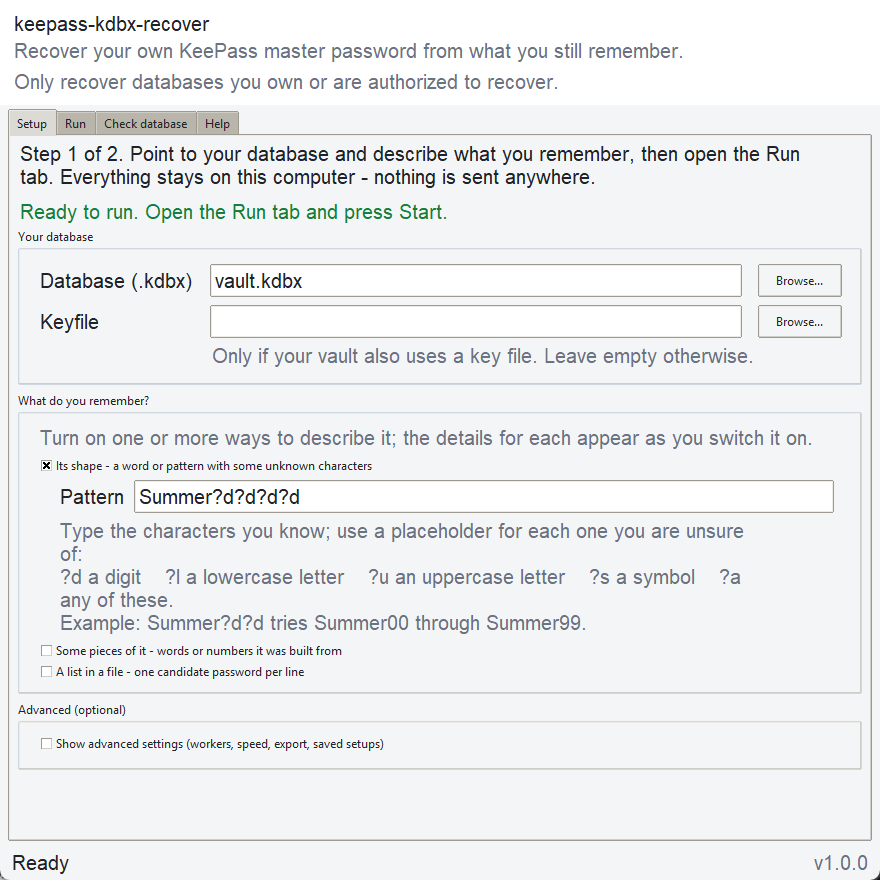

# keepass-kdbx-recover

Recover the master password of your own KeePass database from what you still
remember.

`Python 3.11+` | `AGPL-3.0-only`

keepass-kdbx-recover does not break the encryption. It builds candidate passwords
from what you remember (the shape of the password, a few pieces of it, or a
wordlist) and tries them against your database until one opens it. It works with
KDBX 3.1 and 4.x, AES-KDF and Argon2, with or without a keyfile, from the command
line or from a small desktop window.

> Use it only on databases you own or are authorized to recover.



## Why

I once locked myself out of my own KeePass vault. I knew roughly what the master
password looked like, but not the exact string, and two quick scripts that tried
the combinations I could remember got my data back. This is the same idea rebuilt
as a tested tool. It cannot find a password you have truly forgotten; it turns
"I remember most of it" into an organized search you can stop and resume.

## Install

```bash
git clone https://github.com/HighMarck17/keepass-kdbx-recover
cd keepass-kdbx-recover
pip install .
```

This installs `keepass-kdbx-recover` (also available as `kpr`) and
`keepass-kdbx-recover-gui`. The only runtime dependencies are `pykeepass` and
`tomlkit`.

On Windows you can also build a standalone GUI that needs no Python. From the
repository root, in a virtual environment with the dev extras installed:

```powershell
./packaging/build_exe.ps1
```

The result is the folder `dist/keepass-kdbx-recover-gui/`; run
`keepass-kdbx-recover-gui.exe` inside it, or zip the folder to share it. The build
is unsigned, so an antivirus may flag it as a false positive.

## Quick start

The wizard asks a few questions, writes `config.toml` and prints the command to run:

```bash
keepass-kdbx-recover wizard
keepass-kdbx-recover run
```

Or open the window with `keepass-kdbx-recover-gui`.

## Describe what you remember

There are three sources of candidates. You can enable more than one; they are tried
in the order mask, fragments, wordlist.

**Mask: you remember the structure.** Placeholders follow the hashcat syntax and any
other character is kept as typed. An unknown placeholder such as `?x` is reported as
an error.

| Placeholder | Matches |
| --- | --- |
| `?l` | `a-z` |
| `?u` | `A-Z` |
| `?d` | `0-9` |
| `?s` | the common symbols `!@#$%^&*_-` |
| `?a` | any of the above |
| `??` | a literal `?` |

```bash
# Summer0000 ... Summer9999
keepass-kdbx-recover run --db vault.kdbx --mask "Summer?d?d?d?d"
```

**Fragments: you remember pieces.** The pieces are combined in every subset from
`--min-fragments` (default 1) up to all of them. `--permute` also tries every order
and `--case-variants` adds the lower, UPPER and Capitalized form of each piece. In
the config file, `fragments.fixed_prefix` keeps one piece always first. Repeated
candidates are dropped as long as the space is small enough to count (up to
500,000).

```bash
keepass-kdbx-recover run --db vault.kdbx --fragments "sun,flower,42" --permute
```

**Wordlist: you already have a list.** The file is read one line at a time, so its
size does not matter. Lines are not deduplicated and undecodable bytes are skipped.

```bash
keepass-kdbx-recover run --db vault.kdbx --wordlist words.txt
```

## Check the database first

How fast candidates can be tested depends on the key derivation function (KDF) the
database uses, and `inspect` reads it from the unencrypted header:

```bash
keepass-kdbx-recover inspect vault.kdbx
```

```
KDBX format : 4.1
Cipher      : AES-256
KDF         : Argon2id
  memory    : 67,108,864 bytes (~64 MiB)
  iterations: 10
  parallel. : 4
  => Argon2 is memory-hard: a GPU gives LITTLE advantage; use CPU here.
```

- **Argon2** (the default since KDBX 4) is memory-hard: every attempt needs a large
  block of RAM, so a GPU gains little and the built-in CPU run is the right tool.
  For the same reason more workers do not mean more speed, and the automatic worker
  count is capped at `min(6, CPU count)`.
- **AES-KDF** (the KDBX 3.1 default) is compute-bound, so a GPU is much faster.
  `export` writes the candidates to a plain wordlist and prints the matching hashcat
  command.

## Commands

| Command | What it does |
| --- | --- |
| `run` | test the candidates against the database (the default when no command is given) |
| `inspect [PATH]` | report format, cipher and KDF, with advice on GPU use |
| `export --out FILE` | write the candidates to a file, one per line |
| `wizard` | guided setup that writes the config file |
| `gui` | open the desktop window |

`run` and `export` accept the same options. Command-line options override the config
file, which overrides the built-in defaults.

| Option | Meaning |
| --- | --- |
| `--config PATH` | config file (default `config.toml`) |
| `--db PATH`, `--keyfile PATH` | database and optional keyfile |
| `--workers N` | worker processes, `0` for automatic |
| `--mask PATTERN` | enable the mask source |
| `--fragments a,b,c` | enable the fragments source |
| `--wordlist PATH` | enable the wordlist source |
| `--min-fragments N` | smallest number of pieces per candidate |
| `--permute`, `--no-permute` | try every order, or keep the given order |
| `--case-variants`, `--no-case-variants` | add case variants of each piece |

Exit codes: `0` success (for `run`, the password was found), `1` not found, `2`
invalid configuration or missing input file, `3` runtime error such as a corrupt
database or an unreadable keyfile.

KeePass derives a single key from the password and the keyfile together, so a
wrong keyfile looks exactly like a wrong password. If nothing is found, check the
keyfile first.

The progress line shows a percentage and an ETA only when the total is known, that
is when only the mask or only the fragments source is active (fragments up to
500,000 candidates). Otherwise it shows the count, the rate and the elapsed time.
Ctrl+C stops a run.

## Configuration

The wizard and the GUI write the config file for you, and it is plain TOML you can
also edit by hand. [`config.example.toml`](config.example.toml) lists every key with
a comment. With `export.enabled = true`, `run` and the GUI write the candidates to
`export.path` instead of testing them. The file is checked before any work starts, problems are reported as a
plain message with a non-zero exit code, and saving keeps your comments and any
extra keys.

## GUI

The window has four tabs: **Setup** (database, keyfile, sources and their options,
load and save the config; Start stays disabled until the settings are valid),
**Recovery** (start, cancel, progress, the password with a copy button, a log),
**Inspect** (the same report as `inspect`) and **Help** (a short cheatsheet).
Recovery runs in the background, and closing the window cancels it.

## Development

```bash
pip install -e ".[dev]"
pytest
ruff check src tests
```

The candidate sources (`mask`, `fragments`, `wordlist`, combined in `candidates`),
the config and the header inspector are pure code tested without a database.
`engine` runs the attempts across worker processes and reports progress through one
interface shared by the CLI and the GUI.

CI runs the tests and the linter on Linux and Windows with Python 3.11, 3.12 and
3.13. Pushing a `v*` tag also builds the Windows executable.

After changing the defaults, regenerate the example config with:

```bash
python -c "from keepass_kdbx_recover.config import default, save; save(default(), 'config.example.toml')"
```
